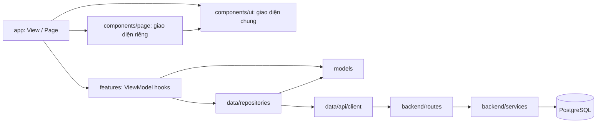
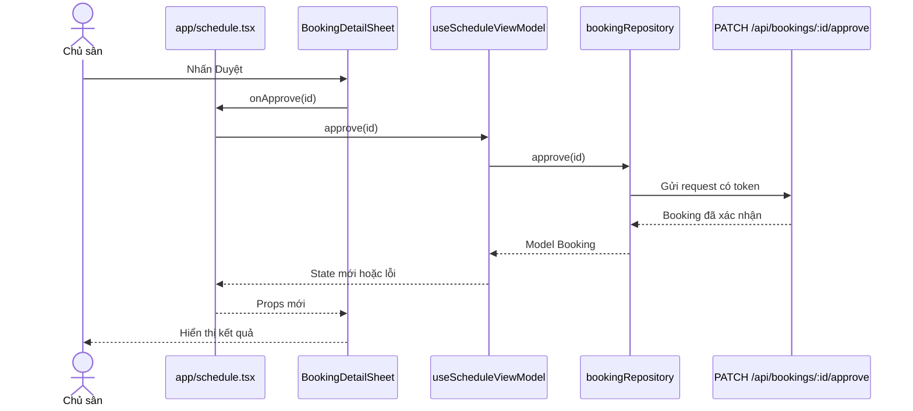

# ShuttleGo — Layered architecture kết hợp MVVM

> Kiến trúc đã được áp dụng cho frontend. Dữ liệu hiện vẫn là dữ liệu mẫu; chưa nối API.

## 1. Quy ước các tầng

| Tầng | Vị trí | Trách nhiệm |
| --- | --- | --- |
| View / Page | `src/app/` | File route của Expo Router. Gọi hook của feature, truyền dữ liệu và callback xuống component. |
| Component riêng của page | `src/components/<page>/` | Chia nhỏ giao diện của page; nhận dữ liệu và callback qua props. |
| Component dùng chung | `src/components/ui/` | Button, card, text, input, modal... tái sử dụng toàn app. Không chứa nghiệp vụ của feature. |
| ViewModel / Feature logic | `src/features/<feature>/` | Hook giữ state, tải dữ liệu, xử lý sự kiện, trạng thái loading/error và biến đổi dữ liệu cho View. |
| Model | `src/models/` | Kiểu dữ liệu và quy tắc thuần, độc lập với React và HTTP. |
| Data | `src/data/` | API client, repository và ánh xạ dữ liệu từ backend. |
| Backend | `backend/src/` | Route, quyền truy cập, nghiệp vụ server và PostgreSQL. Không thuộc MVVM của mobile app. |

`app/` chỉ chứa route/page và `_layout.tsx`. Component riêng của page đặt ngoài `app/` để Expo Router không nhận chúng là route.

## 2. Cây thư mục đích

```text
frontend/src/
├── app/                              # View / Page: mỗi file là một route
│   ├── _layout.tsx
│   ├── index.tsx                      # Tổng quan
│   ├── schedule.tsx                   # Lịch sân
│   ├── revenue.tsx                    # Doanh thu
│   ├── account.tsx                    # Tài khoản
│   ├── notifications.tsx
│   ├── venue-info.tsx
│   ├── pricing.tsx
│   ├── hours.tsx
│   └── explore.tsx                    # redirect cũ nếu còn cần
│
├── components/
│   ├── home/                          # Chỉ dùng cho page Tổng quan
│   │   ├── HomeHeader.tsx
│   │   ├── OverviewStats.tsx
│   │   └── PendingBookingCard.tsx
│   ├── schedule/
│   │   ├── DateSelector.tsx
│   │   ├── CourtScheduleGrid.tsx
│   │   ├── ScheduleLegend.tsx
│   │   └── BookingDetailSheet.tsx
│   ├── revenue/
│   │   ├── RevenueChart.tsx
│   │   ├── RevenueFilters.tsx
│   │   └── BookingHistoryCard.tsx
│   ├── account/                       # AccountProfile, AccountMenu
│   ├── notifications/                 # NotificationList
│   ├── venue/
│   │   ├── SettingsPage.tsx
│   │   ├── VenueInfoForm.tsx
│   │   ├── PricingForm.tsx
│   │   └── OpeningHoursForm.tsx
│   └── ui/                            # Dùng chung toàn app
│       └── owner-ui.tsx               # Page, Text, Header, Card, Button, Chip, Input
│
├── features/                          # ViewModel và logic theo feature
│   ├── home/
│   │   └── hooks/useHomeViewModel.ts
│   ├── schedule/
│   │   └── hooks/useScheduleViewModel.ts
│   ├── revenue/
│   │   └── hooks/useRevenueViewModel.ts
│   ├── account/
│   │   └── hooks/useAccountViewModel.ts
│   ├── notifications/
│   │   └── hooks/useNotificationsViewModel.ts
│   └── venue/
│       └── hooks/
│           ├── useVenueInfoViewModel.ts
│           ├── usePricingViewModel.ts
│           └── useHoursViewModel.ts
│
├── models/                            # Booking, Court, Venue, PriceRule...
├── data/
│   ├── api/client.ts                  # base URL, token, xử lý lỗi HTTP
│   └── repositories/                  # booking, venue, auth, notification
├── navigation/                        # RootNavigator, AppTabs
├── shared/                            # theme, constants, provider, tiện ích chung
└── types/                             # khai báo TypeScript toàn cục

backend/                               # giữ routes → services → PostgreSQL
```

Cây trên mô tả vị trí khi có code tương ứng. Không tạo file rỗng hoặc hook cho page thuần hiển thị. `ui/` là một phần của `components/`; không tạo thêm một bộ UI song song trong `shared/`.

## 3. Sơ đồ phụ thuộc giữa các tầng



Quy tắc: component giao diện không gọi API và không chứa logic nghiệp vụ. Page nối ViewModel với component. Hook không import page hay component. Repository không biết state của React. Có thể dùng model trong props nếu cần kiểu dữ liệu chung.

## 4. Ví dụ một page

```text
app/schedule.tsx
  ├─ useScheduleViewModel()                  # features/schedule/hooks/
  │    ├─ selectedDate, courts, bookings
  │    ├─ loading, error
  │    └─ selectDate(), approve(), reject()
  ├─ <DateSelector ... />                   # components/schedule/
  ├─ <CourtScheduleGrid ... />             # components/schedule/
  └─ <BookingDetailSheet ... />            # components/schedule/
```

Page chứa phần ghép các khối và điều hướng. Chọn ngày, tải lịch, xác định slot và duyệt đơn nằm trong hook. Component chỉ render props và gọi callback.

## 5. Luồng duyệt đơn



## 6. Kết quả áp dụng

| Phần | Vị trí sau khi tái cấu trúc |
| --- | --- |
| Tổng quan | Page ở `app/index.tsx`; component ở `components/home/`; state và thao tác ở `features/home/hooks/`. |
| Lịch sân | Page ở `app/schedule.tsx`; component ở `components/schedule/`; logic ở `features/schedule/hooks/`. |
| Doanh thu | Page ở `app/revenue.tsx`; biểu đồ, bộ lọc và danh sách ở `components/revenue/`; logic ở `features/revenue/hooks/`. |
| Tài khoản và thông báo | Page riêng trong `app/`; component và ViewModel được tách theo feature tương ứng. |
| Thông tin sân, bảng giá, giờ mở cửa | Page riêng trong `app/`; form ở `components/venue/`; logic ở `features/venue/hooks/`. |
| UI dùng chung | Nằm trong `components/ui/`; theme, provider và hook hạ tầng giữ trong `shared/`. |
| Model | Kiểu dữ liệu dùng qua nhiều tầng nằm trong `models/`. |
| Backend | Giữ nguyên `routes → services → PostgreSQL`; sẽ thêm `data/repositories/` ở frontend khi bắt đầu nối API. |

## 7. Những điểm dữ liệu cần giải quyết khi nối API

- Tổng quan và Lịch sân có thể dùng `GET /api/bookings/owner` và `GET /api/venues/:id/availability`.
- Thông báo có API đọc danh sách và đánh dấu đã đọc.
- Doanh thu chưa có API thống kê riêng; phải xác định cách tính theo trạng thái đơn và thanh toán.
- Giờ mở cửa trong database hiện chỉ có `open_time` và `close_time` chung, chưa có lịch riêng theo từng thứ như UI.
- Frontend hiện chưa có luồng đăng nhập và lưu token để gọi API chủ sân.

Các điểm này không làm thay đổi ranh giới các tầng ở trên; xử lý khi bắt đầu nối dữ liệu thật.
