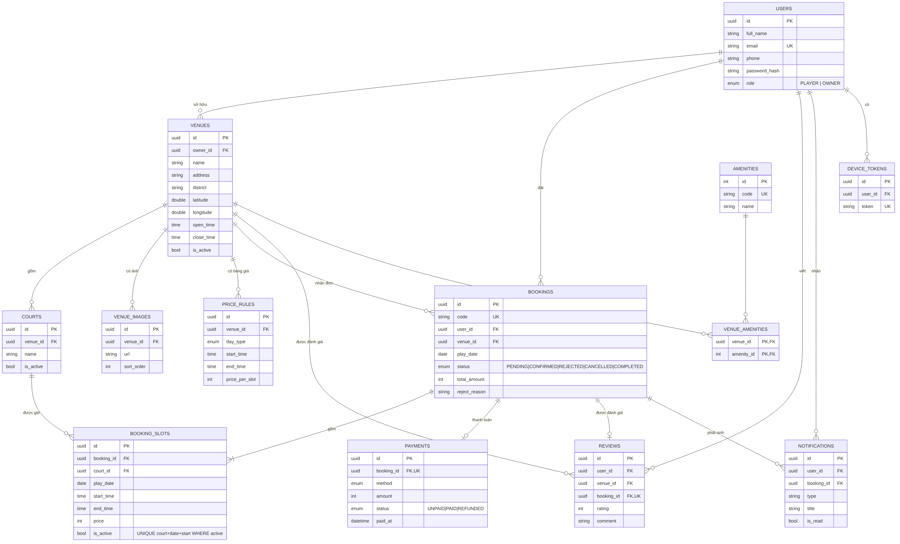
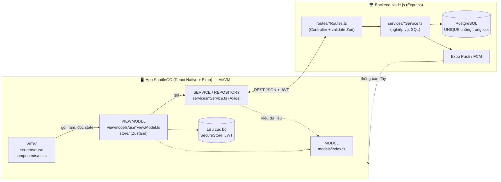

# ShuttleGO – Thiết kế dữ liệu, lưu trữ và kiến trúc

## 1. Mô hình dữ liệu (ERD)



Mã nguồn sơ đồ: `docs/erd.mmd` (Mermaid). Script tạo bảng: `backend/db/schema.sql`.

### 1.1 Danh sách bảng

| # | Bảng | Ý nghĩa | Khóa / ràng buộc chính |
|---|------|---------|------------------------|
| 1 | `users` | Người chơi và chủ sân (phân biệt bằng `role`) | `email` UNIQUE |
| 2 | `venues` | Cơ sở sân (địa chỉ, tọa độ, giờ mở cửa) | FK `owner_id → users`; CHECK `open_time < close_time` |
| 3 | `courts` | Sân con trong một cơ sở (Sân 1, Sân 2…), là các hàng của lưới | FK `venue_id`; UNIQUE (`venue_id`, `name`) |
| 4 | `venue_images` | Ảnh của cơ sở | FK `venue_id` |
| 5 | `amenities` | Danh mục tiện ích (đỗ xe, nước uống, phòng thay đồ…) | `code` UNIQUE |
| 6 | `venue_amenities` | Bảng nối N–N giữa cơ sở và tiện ích | PK (`venue_id`, `amenity_id`) |
| 7 | `price_rules` | Bảng giá theo loại ngày và khung giờ | FK `venue_id`; CHECK `start < end` |
| 8 | `bookings` | Đơn đặt sân (đầu đơn) | `code` UNIQUE; FK `user_id`, `venue_id` |
| 9 | `booking_slots` | Chi tiết đơn, mỗi dòng = 1 sân × 1 khung giờ | **UNIQUE (`court_id`, `play_date`, `start_time`) WHERE `is_active`** |
| 10 | `payments` | Thanh toán mô phỏng VietQR | FK `booking_id` UNIQUE (quan hệ 1–1) |
| 11 | `reviews` | Đánh giá sân sau khi chơi | `booking_id` UNIQUE (mỗi đơn đánh giá 1 lần); CHECK `rating` 1–5 |
| 12 | `notifications` | Thông báo trong app (duyệt, từ chối, nhắc lịch) | FK `user_id`, `booking_id` |
| 13 | `device_tokens` | Expo push token của thiết bị | `token` UNIQUE |

### 1.2 Quan hệ

| Quan hệ | Kiểu | Ghi chú |
|---------|------|---------|
| users – venues | 1 – N | Một chủ sân có nhiều cơ sở (rút ra từ VNSLINK) |
| venues – courts | 1 – N | |
| venues – price_rules / venue_images | 1 – N | |
| venues – amenities | N – N | qua `venue_amenities` |
| users – bookings | 1 – N | Người chơi đặt nhiều đơn |
| venues – bookings | 1 – N | Cơ sở nhận nhiều đơn |
| bookings – booking_slots | 1 – N (≥ 1) | Một đơn gồm nhiều khung liền kề, có thể nhiều sân |
| courts – booking_slots | 1 – N | |
| bookings – payments | 1 – 1 | |
| bookings – reviews | 1 – 0..1 | |
| users – notifications / device_tokens | 1 – N | |

### 1.3 Chống đặt trùng lịch
Mỗi khung giờ được đặt là một dòng trong `booking_slots`. PostgreSQL có **unique index một phần**:

```sql
CREATE UNIQUE INDEX uq_slot_no_double_booking
  ON booking_slots (court_id, play_date, start_time) WHERE is_active;
```

Khi hai người bấm đặt cùng một ô gần như cùng lúc, CSDL chỉ cho một giao dịch thành công. Giao dịch còn lại gặp lỗi `23505` và API trả **409**. Khi đơn bị hủy hoặc bị từ chối, `is_active = false` nên ô đó trống lại mà lịch sử vẫn được giữ. Kiểm thử E2E có trường hợp 3 người đặt cùng lúc, và chỉ đúng 1 người thành công.

Vòng đời đơn: `PENDING` →(chủ sân duyệt)→ `CONFIRMED` →(qua ngày chơi)→ `COMPLETED`. Từ `PENDING` có thể sang `REJECTED`; từ `PENDING`/`CONFIRMED` có thể sang `CANCELLED` (chỉ khi còn ≥ 12 giờ trước giờ chơi).

## 2. Lựa chọn lưu trữ

| Phương án | Đánh giá cho ShuttleGO | Kết luận |
|-----------|------------------------|----------|
| SQLite / **Room** | Room là thư viện Android (Kotlin/Java), không dùng được với React Native. SQLite (`expo-sqlite`) chỉ lưu trên một máy, nên người chơi và chủ sân không thấy chung lịch và không chống trùng được | ❌ Không dùng làm nguồn dữ liệu chính |
| **Firebase** (Firestore) | Đồng bộ thời gian thực tốt, nhưng NoSQL không có UNIQUE/khóa ngoại. Chống trùng phải tự viết transaction và rule; truy vấn lọc theo giá, tiện ích khó | ⚠️ Chỉ dùng **FCM** cho thông báo đẩy |
| **REST API + PostgreSQL** | Dữ liệu dùng chung cho mọi người, có ràng buộc UNIQUE/FK/CHECK, transaction ACID, JOIN để lọc và thống kê; khớp với công nghệ đã đề xuất | ✅ **Chọn** |

**Lưu cục bộ trên điện thoại** (chỉ là phần phụ):
- JWT lưu bằng `expo-secure-store` (mã hóa, tương tự Keystore/Keychain) để tự đăng nhập lại.
- Các khung giờ đang chọn chỉ giữ trong bộ nhớ (Zustand `bookingDraftStore`). Không lưu lưới sân vào bộ nhớ đệm, vì lưới cũ có thể khiến người dùng đặt nhầm ô đã có người.
- Nếu cần xem offline, có thể thêm `expo-sqlite` hoặc AsyncStorage để lưu danh sách sân và lịch sử đơn (chỉ đọc).

## 3. Kiến trúc ứng dụng



**App mobile – MVVM** (hợp với React hooks hơn MVC):

| Lớp | Thư mục | Trách nhiệm |
|-----|---------|-------------|
| **Model** | `src/models` | Kiểu TypeScript khớp với bảng và API (`Venue`, `Booking`, `GridSlot`…) |
| **View** | `src/screens`, `src/components` | Chỉ hiển thị và bắt sự kiện, không gọi API trực tiếp |
| **ViewModel** | `src/viewmodels`, `src/store` | Custom hook giữ state (loading, dữ liệu, form) và hành động (save, cancel, approve…). Zustand giữ state toàn cục (đăng nhập, slot đang chọn) |
| **Service / Repository** | `src/services` | Gọi REST bằng Axios. `apiClient` tự gắn JWT và đổi lỗi thành câu tiếng Việt |

Luồng ví dụ khi đặt sân: `BookingGridScreen` → `useBookingGridViewModel.submit()` → `bookingService.create()` → `POST /api/bookings`. Nếu nhận 409, ViewModel tải lại lưới và báo lỗi.

**Backend – phân lớp kiểu MVC:** `routes` (đóng vai Controller: nhận request, validate bằng Zod) → `services` (nghiệp vụ và SQL có tham số) → PostgreSQL. Lỗi được gom về `errorHandler` và trả mã HTTP thống nhất.

## 4. Cấu trúc thư mục

```
shuttlego/
├── docs/                    THIET_KE.md, erd.mmd/png, architecture.mmd/png
├── backend/
│   ├── db/schema.sql        tạo bảng, enum, ràng buộc, dữ liệu tiện ích
│   ├── scripts/seed.ts      dữ liệu mẫu (2 cơ sở, tài khoản demo)
│   ├── scripts/e2e.ts       66 kiểm thử đầu-cuối
│   └── src/
│       ├── config/db.ts     Pool pg, q()/q1()/tx(), tự đổi snake_case → camelCase
│       ├── middleware/auth.ts  JWT, requireAuth, requireOwner
│       ├── routes/          auth, venue, court/price, booking, misc (review, notification, amenity)
│       ├── services/        authService, venueService, bookingService, reviewService, notificationService
│       ├── utils/           http.ts (HttpError, errorHandler), time.ts (slot, giá, giờ VN)
│       ├── app.ts           ghép route
│       └── server.ts        chạy server + job nhắc lịch mỗi 5 phút
└── mobile/
    ├── App.tsx, index.ts, app.json (extra.apiUrl)
    └── src/
        ├── config/env.ts
        ├── models/          Model
        ├── services/        apiClient, auth/venue/booking/notificationService
        ├── store/           authStore (SecureStore), bookingDraftStore
        ├── viewmodels/      useAuth/Profile/VenueList/BookingGrid/MyBookings/OwnerVenue/OwnerBookings/Notifications ViewModel
        ├── screens/         Auth, VenueList, VenueDetail (bản đồ), BookingGrid, Payment (VietQR), MyBookings,
        │                    Notifications, Profile, OwnerScreens (duyệt lịch, sân của tôi), VenueForm
        ├── components/ui.tsx   Button, Input, Card, StatusBadge
        ├── navigation/      Stack + Tab theo vai trò (người chơi / chủ sân)
        └── utils/           format tiền, ngày; useAsyncAction (loading + Alert lỗi)
```

## 5. Thao tác thêm – sửa – xóa (CRUD)

| Đối tượng | Thêm | Xem | Sửa | Xóa | Màn hình |
|-----------|------|-----|-----|-----|----------|
| Tài khoản / hồ sơ | `POST /auth/register` | `GET /auth/me` | `PUT /auth/me`, `PUT /auth/password` | – | Đăng ký, Tài khoản |
| Cơ sở sân | `POST /venues` | `GET /venues?q=&district=&maxPrice=&amenities=`, `GET /venues/:id` | `PUT /venues/:id` (cả tiện ích, bật/tắt hoạt động) | `DELETE /venues/:id` (chặn nếu đã có đơn) | Sân của tôi, Form cơ sở |
| Sân con | `POST /venues/:id/courts` | trong chi tiết | `PUT /courts/:id` | `DELETE /courts/:id` (chặn nếu đã có lịch) | Form cơ sở |
| Bảng giá | `POST /venues/:id/price-rules` | trong chi tiết | `PUT /price-rules/:id` | `DELETE /price-rules/:id` | Form cơ sở |
| Đơn đặt sân | `POST /bookings` | `GET /bookings/mine`, `/owner`, `/:id`, `GET /venues/:id/availability?date=` | `PATCH /:id/cancel`, `/approve`, `/reject`, `POST /:id/pay` | `DELETE /bookings/:id` (đơn đã hủy/bị từ chối) | Lưới giờ, Thanh toán, Lịch đặt, Duyệt lịch |
| Đánh giá | `POST /reviews` | `GET /venues/:id/reviews` | `PUT /reviews/:id` | `DELETE /reviews/:id` | Lịch đặt |
| Thông báo | (server tạo) | `GET /notifications` | `PATCH /:id/read`, `/read-all` | `DELETE /notifications/:id` | Thông báo |

Mọi đường dẫn đều có tiền tố `/api`. Người chơi gọi các API của chủ sân sẽ nhận 403. Sửa hoặc xóa dữ liệu của người khác cũng nhận 403/404.
